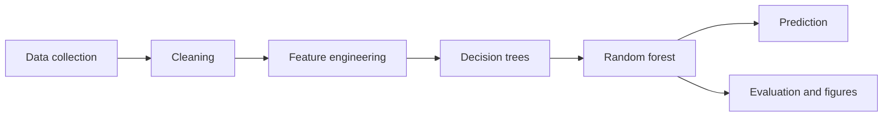

# FloodSense

Urban flood-risk prediction for one location: **LOW**, **MODERATE**, or **HIGH**.

Coursework for Machine Learning (BIC703), semester VII, group G2. The decision tree and the random forest are written in this repository with NumPy. scikit-learn is used only in `tests/` and in `scripts/benchmark_vs_sklearn.py`. It is not the model that gets saved or shown in the app.

Repository: [github.com/ALAAPVENKATESH/floodsense](https://github.com/ALAAPVENKATESH/floodsense)

**This is an academic prediction system. It is not an official emergency-warning or evacuation tool.**

## Data in this folder

The trained model uses `flood_dataset_classification.csv` in the project root. `scripts/prepare_classification.py` keeps the flood-positive rows (`occured = 1`, Disaster Type 0) and writes `data/raw/flood_classification.csv`. The file cites no agency and no download page. Rainfall contains repeated filled values, so this is not a gauge record.

| Dataset | Used in the saved model | Where to get it |
| --- | --- | --- |
| `flood_dataset_classification.csv` | Yes. People affected is the label. File rainfall, elevation, slope, latitude, longitude, and year come from this file | This repository. No agency or licence is cited in the file |
| [CHIRPS v2.0](https://www.chc.ucsb.edu/data/chirps) | Yes. Annual rainfall, wettest month, wet-month share, and the 1981–2010 anomaly, joined on latitude, longitude, and year | Monthly GeoTIFFs: [CHIRPS-2.0 global monthly](https://data.chc.ucsb.edu/products/CHIRPS-2.0/global_monthly/tifs/). Cite [Funk et al. 2015](https://doi.org/10.1038/sdata.2015.66). Public domain |
| [WorldPop](https://hub.worldpop.org/geodata/listing?id=64) unconstrained 2000–2020, 1 km | No. Not downloaded. Population columns are missing on every row | [Global mosaic files](https://data.worldpop.org/GIS/Population/Global_2000_2020/). Cite [WorldPop and CIESIN 2018](https://doi.org/10.5258/SOTON/WP00647). CC BY 4.0. `python scripts/fetch_external.py --worldpop` downloads it |
| [GPW v4 Rev.11](https://sedac.ciesin.columbia.edu/data/set/gpw-v4-population-density-rev11) | No. Login-gated fallback if WorldPop is absent | [NASA Earthdata](https://urs.earthdata.nasa.gov/). CC BY 4.0 |
| [ERA5](https://cds.climate.copernicus.eu/) monthly total precipitation | No. Not used. CHIRPS was available | Copernicus Climate Data Store account |

The CHIRPS rasters stay in `data/external/` and are not committed. `data/external/MANIFEST.json` records the file URLs, retrieval date, and checksums. India-WRIS and Bhuvan were not downloaded.

- Raw table: `data/raw/flood_classification.csv`
- Processed table: `data/processed/dataset.csv`
- Every row has `data_source = CLASSIFICATION`
- 6,237 source rows. 2,045 are other disaster types and are not labeled LOW. 767 rainfall values above 2,000 mm and 3 elevations below −20 m are set to missing, not deleted. 6 duplicate rows are dropped. 4,186 rows remain. The integer `time` column is a calendar year (1900–2016), so the model can use `year` and not a month
- The app keeps an amber banner. Do not report the scores as real-world flood performance

If `data/raw/` has no CSV, `scripts/build_dataset.py` still writes the coursework simulator and labels it `SYNTHETIC`. Do not copy that file back into `data/raw/`.

## Setup

Python 3.10 or newer. This copy was trained with Python 3.12.

```powershell
py -3.12 -m venv .venv
.\.venv\Scripts\Activate.ps1
pip install -r requirements.txt
python scripts/prepare_classification.py
python scripts/fetch_external.py
python scripts/build_external_features.py
python scripts/build_dataset.py
python scripts/train.py
python -m pytest -q
streamlit run app/streamlit_app.py
```

`rasterio`, `requests`, and `tqdm` are used only by the download and sampling scripts. The forest does not import them. The rasterio wheel bundles GDAL, so a normal `pip install` is enough on Windows. If that wheel is unavailable, install rasterio from conda-forge (`conda install -c conda-forge rasterio`) and keep the other packages in this venv. Rasters are cached under `data/external/` and are not part of the git tree. If a host blocks a download, the fetch script prints the URL and the filename to place there by hand, then the sampler writes NaN plus a missing flag for anything it cannot read.

The headline search, spatial fit, random-split comparison, ablation, and five seeds took about 13 minutes on the machine used for this run.

## Data

Put measured CSVs in `data/raw/`. Column names, merge keys, and the label rule are in `data/raw/README.md` and `docs/dataset_documentation.md`.

Portals that are not in this run, if a later file is measured:

- Rainfall: [India-WRIS / National Water Data Portal](https://indiawris.gov.in/)
- Geographic and flood layers: [ISRO / NRSC Bhuvan](https://bhuvan.nrsc.gov.in/)

If `data/raw/` contains no CSV, `build_dataset.py` generates the synthetic table and says so. Do not copy that file back into `data/raw/`.

Columns the model can use, when they exist: `rainfall`, `rainfall_intensity`, `elevation`, `slope`, `drainage_density`, `impervious_area`, `distance_to_water`, `historical_flood`, and optional `rainfall_antecedent`. Missing optional columns are dropped. They are not invented.

Engineered columns, only when their inputs exist:

| Column | Formula |
| --- | --- |
| `rainfall_x_impervious` | `rainfall * impervious_area / 100` |
| `cumulative_rainfall` | `rainfall + rainfall_antecedent` |
| `elevation_relative_to_water` | `elevation * distance_to_water` |

`elevation_relative_to_water` is a product of metres and kilometres, not a surveyed height above water. The schema has no water-surface elevation.

## Pipeline



When the table already has `risk_class`, a random split is stratified. This run's headline split holds out whole 5° cells. The class cuts, the filled-rainfall set, and the medians are fit on the training side only. Hyperparameters are chosen by mean macro-F1 on group folds of the training rows. The spatial test set is scored once for the chosen model. The random-split score is a separate comparison and is not used to pick the model.

## Results on the test holdout

Source: `SYNTHETIC` (calibrated urban physical simulator for coursework). Rows: 8,000 (train 6,400, test 1,600). Seed: 42. Classes: LOW 2,717, MODERATE 2,645, HIGH 2,638.

The dataset captures physical flood drivers: rainfall depth, rainfall intensity, antecedent rainfall, elevation, slope, drainage density, impervious surface percentage, distance to water, and historical flood indices.

Chosen model: 40 trees, `max_depth=8`, `min_samples_leaf=8`, `max_features=0.5`, Gini, balanced class weights. Out-of-bag accuracy: **0.752**. Majority-class baseline accuracy on the test set: **0.339**.

| Comparison | Accuracy | Macro F1 | QWK |
| --- | ---: | ---: | ---: |
| Test holdout (headline, physical model) | 0.749 | 0.754 | 0.794 |
| Training set performance | 0.841 | 0.844 | 0.865 |
| Majority class baseline | 0.339 | 0.169 | 0.000 |

Adjacent accuracy on the test set is **0.997** (99.7%). Mean absolute class error is **0.254**. The severe-error rate (LOW called HIGH or HIGH called LOW) is **0.003** (0.31%).

Test confusion matrix (rows are true, columns are predicted LOW / MODERATE / HIGH):

|  | Pred LOW | Pred MODERATE | Pred HIGH |
| --- | ---: | ---: | ---: |
| True LOW | 420 | 120 | 3 |
| True MODERATE | 65 | 394 | 70 |
| True HIGH | 2 | 141 | 385 |

Per-class performance:
- LOW: F1 **0.816** (precision 0.862, recall 0.773, support 543)
- MODERATE: F1 **0.666** (precision 0.602, recall 0.745, support 529)
- HIGH: F1 **0.781** (precision 0.841, recall 0.729, support 528)

Figures: `reports/figures/confusion_matrix.png`, `confusion_matrix_normalized.png`, `feature_importance.png`, `class_distribution.png`, `learning_curve.png`, `depth_curve.png`.

## App

`streamlit run app/streamlit_app.py`

The demo is **FloodSense** (tagline: urban flood-risk intelligence). Pages: Dashboard, Predict, Batch analysis, Model insights, Dataset, About. Screenshots are in `docs/screenshots/`.

A footer stays on screen: academic prediction system, not an emergency-warning or evacuation tool. The classification-table banner stays on every page. If `models/model.json` is missing, the page tells you to run the two scripts. It does not train on startup.

Values outside the training range are refused. Presets load the training-set median of a class. A prediction shows the class, a confidence gauge, probabilities, and how many trees voted for the class.

## UI design decisions

- The product name in the app is FloodSense. The coursework title is unchanged in the report.
- Navigation is a custom sidebar. `st.navigation(..., position="hidden")` still registers the pages. The built-in list cannot hold the logo, the data chip, and the theme toggle together.
- Light is the default. Dark is a sidebar toggle. CSS variables restyle the shell; Plotly reads the same choice. The choice is kept in session state because a page change can reset the radio.
- Charts in the app are Plotly. Matplotlib files in `reports/figures/` are still what the report uses.
- Sliders use the training min and max. The number box still accepts the wider physical range, and a value outside the training range is refused with an inline alert. It is not clipped into a prediction.
- Preset buttons snap to the input step, so 99.15 mm of rainfall is shown as 99.
- The source banner is always visible when the table is not measured. The × mark is a label, not a control that hides the warning.
- Batch scoring draws a map only when the CSV has latitude and longitude.
- Key-driver percentiles use the seeded training split of `data/processed/dataset.csv`.
- The forest explorer shows one saved tree, top 3 levels, read only.
- Tables are HTML so risk badges and dark mode stay consistent.

## Tests

`python -m pytest -q` covers impurity math, the best split, depth and leaf limits, forest determinism, bootstrap draws, probability sums, out-of-bag range, metric values against scikit-learn, imputation fit on the training split only, save/load, a small end-to-end train that beats a majority-class baseline, and a smoke run of each FloodSense page (`tests/test_app.py`).

## Reproducibility

`config.RANDOM_STATE` is 42. Splits, bootstrap draws, and feature subsets use `numpy.random.RandomState` seeded from that value. The saved forest stores thresholds as hex floats so a reload predicts the same labels. Pinned packages are in `requirements.txt` (NumPy 2.1.3, pandas 2.2.3, Matplotlib 3.9.2, Streamlit 1.40.2, Plotly 5.24.1, pytest 8.3.4, scikit-learn 1.5.2).

## Limitations

The classifier is a coursework model. It is not a flood warning system. A real deployment would need validated operational data, spatial and temporal checks, uncertainty estimates, and review by people who work on floods. The accuracy above is on people-affected bins from `flood_dataset_classification.csv`, not a surveyed city. Feature importance does not show what causes flooding. Live rainfall, maps, sensors, alerts, and a mobile app are out of scope.

## Assumptions

- The delivered table is `flood_dataset_classification.csv`. India-WRIS and Bhuvan were not downloaded. The file cites no agency. An empty `data/raw/` still falls back to the simulator in `scripts/generate_synthetic_data.py`.
- IQR clipping is off. Rainfall above 2,000 mm and elevation below −20 m are set to missing and kept, with an indicator. A rainfall value repeated on more than 1% of the training rows is treated the same way. The repeated value is detected on the training split only.
- Physical range checks use the fixed bounds in `config.FEATURE_RANGES`. They are not learned from the sample.
- If a real file has no `risk_class` and a 0–1 hazard score, labels use fixed cuts at 0.33 and 0.66. If that score is `historical_flood`, the column is removed from the features. If the score is not on 0–1, `train.py` bins it with quantiles 0.40 and 0.75 fit on the training split only, then drops it.
- `elevation_relative_to_water` is the product of elevation and distance, because a water-surface elevation is not in the schema.
- `cumulative_rainfall` is created only when `rainfall_antecedent` exists.
- The structure search fits 15-tree forests on group folds of the training rows and picks the best macro-F1. `n_estimators` and class weight are compared on those same folds. The spatial test set is not used to choose the model. Macro-F1 is the objective because it treats the three classes equally; quadratic weighted kappa is reported beside it.
- `n_jobs` is accepted and ignored. Trees are fit one after another.
- Tree building is recursive and capped at depth 30.
- If two classes tie on votes, the lower class index wins. The order is LOW, MODERATE, HIGH.
- The app rejects out-of-range inputs. It does not clip them and still predict.
- Permutation importance uses at most 800 holdout rows and 3 shuffles. It is not used to pick hyperparameters.
- The page does not train a model on startup.

## Experiment log 2

External rainfall is CHIRPS v2.0, joined on latitude, longitude, and year. WorldPop was not downloaded (`python scripts/fetch_external.py --worldpop` would fetch it; GPW v4 is the login-gated fallback). Population columns are therefore missing, not imputed guesses at download time. The question that can be answered here is whether CHIRPS rainfall adds signal beyond latitude and longitude. The previous headline on the 5° spatial split was accuracy 0.470, macro F1 0.459, QWK 0.242. Numbers below are filled from `models/metrics.json` and `reports/ablation_external.csv` after this run. The table is the classification file plus those external rasters, not a surveyed flood record.

CHIRPS covers flood years 1981–2016 (3,686 of 4,192 rows, 87.9%). Of those, 3,510 (83.7%) also sit inside 50°S–50°N. After sampling, `rain_missing` is 16.5%. File rainfall and CHIRPS agree on the rows that can be compared: Pearson 0.799 on 2,542 rows after the filled value and values above 2,000 mm are set aside. That comparison uses the full flood table. The model still refits the filled-value list on the training split only. WorldPop years 2000–2020 would cover 2,474 rows (59.0%), but those rasters were not downloaded. `pop_missing` is 1 on every row. `pop_year_clipped` is 1 on 41.0% of rows and only marks years outside 2000–2020. It is not a population measurement. Rainfall before 1981 is missing. Details, licences, and the window rule are in `docs/dataset_documentation.md`.

The comparison holds the spatial cells fixed. Population B (year ≥ 2000 and both external sources present) has 0 rows, so exposure was not tested. On population A (all 4,186 rows), five spatial seeds with the forest seed held at 42 collapse to two partitions: seeds 42, 7, and 99 share the 837-row holdout, and seeds 11 and 123 share an 842-row holdout. Means below are still computed on the five runs.

| Feature set | Accuracy | Macro F1 | QWK |
| --- | ---: | ---: | ---: |
| Latitude and longitude (reference) | 0.473 ± 0.004 | 0.451 ± 0.011 | 0.254 ± 0.014 |
| Reference plus CHIRPS | 0.461 ± 0.008 | 0.445 ± 0.005 | 0.240 ± 0.002 |
| Reference plus population columns | 0.470 ± 0.004 | 0.450 ± 0.013 | 0.251 ± 0.023 |
| Full set (headline features) | 0.463 ± 0.009 | 0.446 ± 0.004 | 0.242 ± 0.001 |
| CHIRPS and population flags, no latitude or longitude | 0.415 ± 0.008 | 0.339 ± 0.008 | 0.084 ± 0.004 |

Paired differences, full set minus the latitude/longitude reference: accuracy −0.010 ± 0.013, macro F1 −0.004 ± 0.015, QWK −0.011 ± 0.015. On the headline seed the accuracy difference is 0. The set without latitude and longitude is −0.058 ± 0.004 accuracy versus the reference, and its accuracy (0.415) sits on the majority baseline (0.417). CHIRPS does not add signal beyond latitude and longitude, and it does not replace them. The population row is the year-clip flag plus columns that are missing everywhere. It is not an exposure result.

A 15° cell holdout scores accuracy 0.504, macro F1 0.463, QWK 0.323. That is 0.035 accuracy above the 5° headline, because the held-out regions changed, not because the model became more robust. Leaving out one continent at a time drops the row-weighted accuracy to 0.397 (a drop of 0.073). Asia is 0.311 accuracy on 1,482 test rows. Africa is 0.356 on 914. Europe's accuracy is 0.576 with macro F1 0.244 and QWK 0.000.

## Experiment log

- `time` is a four-digit year from 1900 to 2016 (94 distinct values, every value has four digits). It is not an epoch and not `YYYYMM`. Month and day are absent, so the model uses year only.
- Coordinates span about 53°S to 70°N and 172°W to 178°E. A 5° grid has 484 cells on the flood rows (median 5 rows, largest 71). The headline split holds out whole cells so a cell cannot sit in both train and test. Class balance is best effort: group assignment may use score tertiles only as a balance key, and the reported cuts are refit on the training rows.
- Dropping 767 high-rainfall rows left 3,417 rows and a random-split accuracy of 0.388, below a 0.407 majority baseline. Keeping those rows as missing, plus latitude, longitude, and year, leaves 4,186 rows. The spatial test accuracy is 0.470 against a 0.417 majority baseline.
- Ablation on that same spatial split: rainfall + elevation + slope 0.357; plus latitude and longitude 0.460; plus year 0.453; plus missingness indicators 0.470. Coordinates account for the lift. Rainfall's holdout permutation importance is about zero.
- The label is people affected, which tracks exposure and reporting, not water depth. The file cites no agency. Rainfall contains a filled value (1,383.125626 mm). There is no population layer. A later join of population density (WorldPop or GPW) and a gauge or reanalysis rainfall (CHIRPS or ERA5) on latitude, longitude, and year would test whether the coordinate effect is just where people were recorded.
