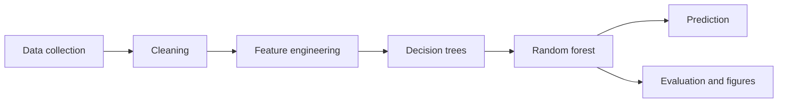

# FloodSense

Urban flood-risk prediction for one location: **LOW**, **MODERATE**, or **HIGH**.

Coursework for Machine Learning (BIC703), semester VII, group G2. The decision tree and the random forest are written in this repository with NumPy. scikit-learn is used only in `tests/` and in `scripts/benchmark_vs_sklearn.py`. It is not the model that gets saved or shown in the app.

Repository: [github.com/ALAAPVENKATESH/floodsense](https://github.com/ALAAPVENKATESH/floodsense)

**This is an academic prediction system. It is not an official emergency-warning or evacuation tool.**

## Synthetic data in this folder

`data/raw/` had no measured CSV when this project was built, so the pipeline wrote a simulator table.

- File: `data/processed/flood_synthetic.csv` (same rows as `data/processed/dataset.csv`)
- Every row has `data_source = SYNTHETIC`
- `scripts/build_dataset.py` prints a warning on stderr
- The Streamlit app shows a banner when the trained model used this table

The numbers in this README are performance on that simulator. They are not real-world flood performance.

## Setup

Python 3.10 or newer. This copy was trained with Python 3.12.

```powershell
py -3.12 -m venv .venv
.\.venv\Scripts\Activate.ps1
pip install -r requirements.txt
python scripts/build_dataset.py
python scripts/train.py
python -m pytest -q
streamlit run app/streamlit_app.py
```

Training the 8,000-row table took about 51 seconds on the machine used for this submission, including the small validation search.

## Data

Put measured CSVs in `data/raw/`. Column names, merge keys, and the label rule are in `data/raw/README.md` and `docs/dataset_documentation.md`.

Credible public sources to cite when you add files:

- Rainfall: National Water Data Portal / India-WRIS
- Geographic and flood layers: ISRO / NRSC Bhuvan

If `data/raw/` contains no CSV, `build_dataset.py` generates the synthetic table and says so. Do not copy that file back into `data/raw/`.

Columns the model can use, when they exist: `rainfall`, `rainfall_intensity`, `elevation`, `slope`, `drainage_density`, `impervious_area`, `distance_to_water`, `historical_flood`, and optional `rainfall_antecedent`. Missing optional columns are dropped. They are not invented.

Engineered columns, only when their inputs exist:

| Column | Formula |
| --- | --- |
| `rainfall_x_impervious` | `rainfall * impervious_area / 100` |
| `cumulative_rainfall` | `rainfall + rainfall_antecedent` |
| `elevation_relative_to_water` | `elevation * distance_to_water` |

`elevation_relative_to_water` is a product of metres and kilometres, not a surveyed height above water. The schema has no water-surface elevation.

## Pipeline



`scripts/train.py` splits first (stratified, seed 42, 20% test). Imputation statistics are fit on the training split only. A second split of the training rows is used to choose `max_depth`, `min_samples_leaf`, and `max_features`. The chosen structure is refit on the full training split with 40 trees. The test set is scored once.

## Results on the synthetic holdout

Source: `SYNTHETIC`. Rows: 8,000 (train 6,400, test 1,600). Seed: 42.

Chosen model: 40 trees, `max_depth=8`, `min_samples_leaf=8`, `max_features=0.5`, Gini, balanced class weights, bootstrap. Out-of-bag accuracy: **0.604**. Majority-class accuracy on the test set: **0.343**.

| Split | Accuracy | Macro precision | Macro recall | Macro F1 |
| --- | ---: | ---: | ---: | ---: |
| Train | 0.713 | 0.727 | 0.714 | 0.716 |
| Test | 0.617 | 0.632 | 0.617 | 0.622 |

Train minus test accuracy is 0.096.

Test set, by class:

| Class | Precision | Recall | F1 | Support |
| --- | ---: | ---: | ---: | ---: |
| LOW | 0.720 | 0.617 | 0.665 | 549 |
| MODERATE | 0.474 | 0.569 | 0.517 | 531 |
| HIGH | 0.703 | 0.665 | 0.684 | 520 |

Test confusion matrix (rows are true, columns are predicted LOW / MODERATE / HIGH):

|  | Pred LOW | Pred MODERATE | Pred HIGH |
| --- | ---: | ---: | ---: |
| True LOW | 339 | 175 | 35 |
| True MODERATE | 118 | 302 | 111 |
| True HIGH | 14 | 160 | 346 |

The middle class is the hardest. LOW and HIGH are less often swapped with each other.

Largest impurity importances: `rainfall_x_impervious` (0.241), `drainage_density` (0.142), `elevation_relative_to_water` (0.107). Permutation importance on the holdout ranks the same three first. `rainfall` by itself is near zero because the engineered rainfall terms already carry that signal. Importance is model behavior, not causation.

Figures: `reports/figures/confusion_matrix.png`, `confusion_matrix_normalized.png`, `feature_importance.png`, `permutation_importance.png`, `class_distribution.png`, `learning_curve.png`, `depth_curve.png`.

## App

`streamlit run app/streamlit_app.py`

The demo is **FloodSense** (tagline: urban flood-risk intelligence). Pages: Dashboard, Predict, Batch analysis, Model insights, Dataset, About. Screenshots are in `docs/screenshots/`.

A footer stays on screen: academic prediction system, not an emergency-warning or evacuation tool. If the model was trained on synthetic rows, an amber banner stays on every page. If `models/model.json` is missing, the page tells you to run the two scripts. It does not train on startup.

Values outside the training range are refused. Presets load the training-set median of a class. A prediction shows the class, a confidence gauge, probabilities, and how many trees voted for the class.

## UI design decisions

- The product name in the app is FloodSense. The coursework title is unchanged in the report.
- Navigation is a custom sidebar. `st.navigation(..., position="hidden")` still registers the pages. The built-in list cannot hold the logo, the data chip, and the theme toggle together.
- Light is the default. Dark is a sidebar toggle. CSS variables restyle the shell; Plotly reads the same choice. The choice is kept in session state because a page change can reset the radio.
- Charts in the app are Plotly. Matplotlib files in `reports/figures/` are still what the report uses.
- Sliders use the training min and max. The number box still accepts the wider physical range, and a value outside the training range is refused with an inline alert. It is not clipped into a prediction.
- Preset buttons snap to the input step, so 99.15 mm of rainfall is shown as 99.
- The synthetic banner is always visible. The × mark is a label, not a control that hides the warning.
- Batch scoring draws a map only when the CSV has latitude and longitude.
- Key-driver percentiles use the seeded training split of `data/processed/dataset.csv`.
- The forest explorer shows one saved tree, top 3 levels, read only.
- Tables are HTML so risk badges and dark mode stay consistent.

## Tests

`python -m pytest -q` covers impurity math, the best split, depth and leaf limits, forest determinism, bootstrap draws, probability sums, out-of-bag range, metric values against scikit-learn, imputation fit on the training split only, save/load, a small end-to-end train that beats a majority-class baseline, and a smoke run of each FloodSense page (`tests/test_app.py`).

## Reproducibility

`config.RANDOM_STATE` is 42. Splits, bootstrap draws, and feature subsets use `numpy.random.RandomState` seeded from that value. The saved forest stores thresholds as hex floats so a reload predicts the same labels. Pinned packages are in `requirements.txt` (NumPy 2.1.3, pandas 2.2.3, Matplotlib 3.9.2, Streamlit 1.40.2, Plotly 5.24.1, pytest 8.3.4, scikit-learn 1.5.2).

## Limitations

The classifier is a coursework model. It is not a flood warning system. A real deployment would need validated operational data, spatial and temporal checks, uncertainty estimates, and review by people who work on floods. The synthetic labels are a noisy binning of a hand-written score, so the accuracy above is an upper-bound style of check on the code, not a measure of skill on a city. Feature importance does not show what causes flooding. Live rainfall, maps, sensors, alerts, and a mobile app are out of scope.

## Assumptions

- No measured CSV was in `data/raw/`. India-WRIS and Bhuvan were not downloaded. The delivered table is the simulator in `scripts/generate_synthetic_data.py`.
- IQR clipping is off. Extreme rainfall is part of the signal, not a row to delete.
- Physical range checks use the fixed bounds in `config.FEATURE_RANGES`. They are not learned from the sample.
- If a real file has no `risk_class` and a 0–1 hazard score, labels use fixed cuts at 0.33 and 0.66. If that score is `historical_flood`, the column is removed from the features. If the score is not on 0–1, `train.py` bins it with quantiles 0.40 and 0.75 fit on the training split only, then drops it.
- `elevation_relative_to_water` is the product of elevation and distance, because a water-surface elevation is not in the schema.
- `cumulative_rainfall` is created only when `rainfall_antecedent` exists.
- The hyperparameter search fits 15-tree forests on a validation split of the training data. The final forest has 40 trees. The test set is not used to choose the model.
- `n_jobs` is accepted and ignored. Trees are fit one after another.
- Tree building is recursive and capped at depth 30.
- If two classes tie on votes, the lower class index wins. The order is LOW, MODERATE, HIGH.
- The app rejects out-of-range inputs. It does not clip them and still predict.
- Permutation importance uses at most 800 holdout rows and 3 shuffles. It is not used to pick hyperparameters.
- The page does not train a model on startup.
